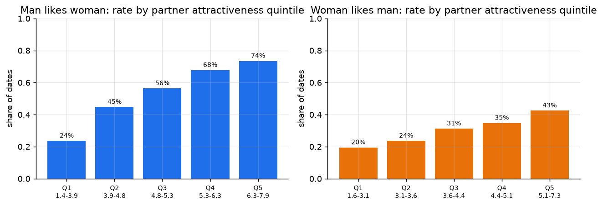
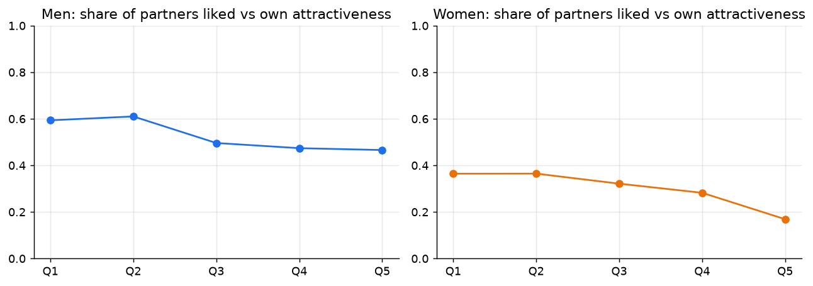
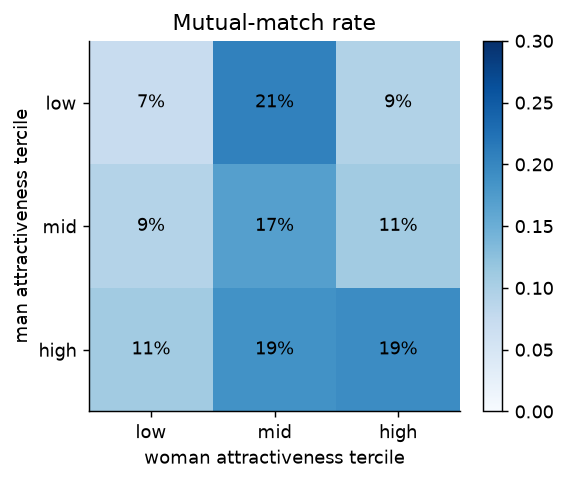
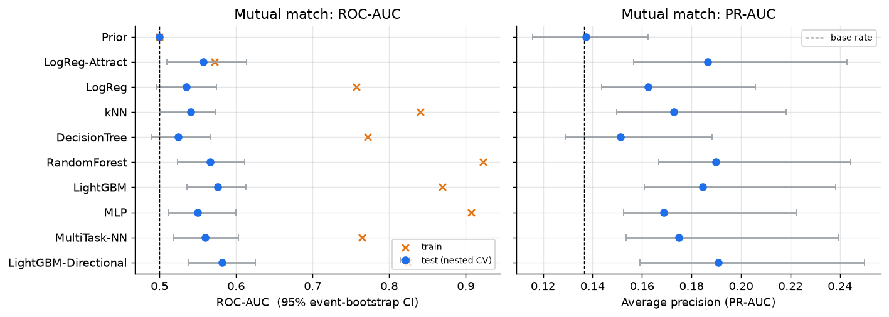
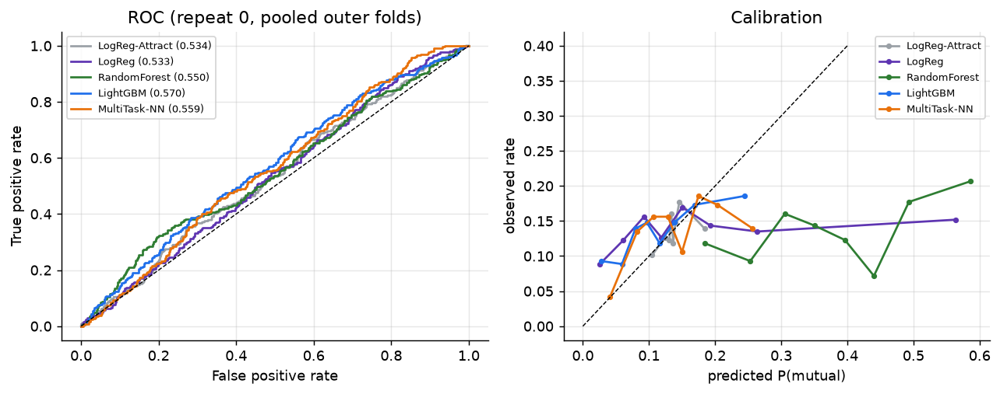
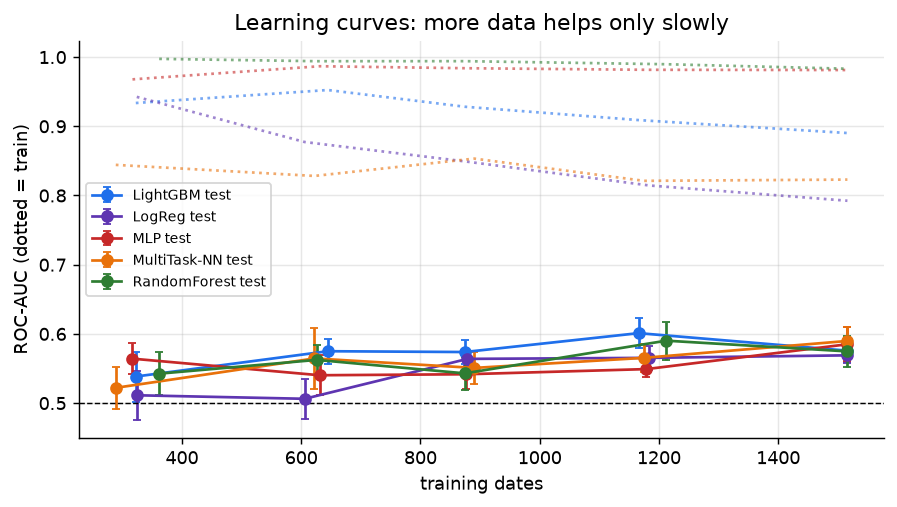
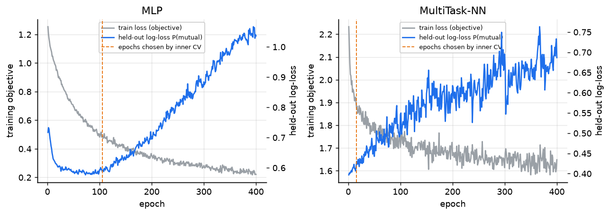
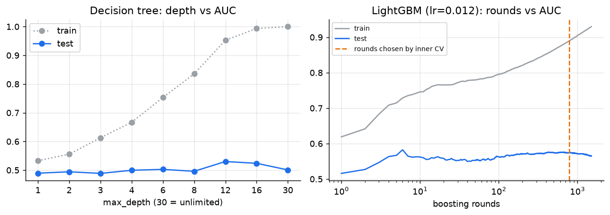
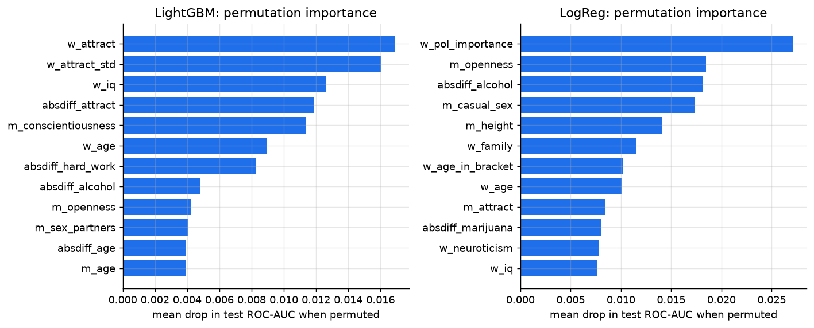

# Can we predict a mutual match before the date? Compatibility prediction on the MixMoSa speed-dating data

*Data Science (CDA), MUIInf, UPV. Report generated 17 Nov 2026. Code: `src/`, raw results: `results/`, figures: `figures/`.*

## 1. Summary

- **Task.** Predict whether a man and a woman will **both** say "yes" after an 8-minute speed date (*mutual match*), using only information available **before** the date: the questionnaire, independent photo-attractiveness ratings and event metadata.
- **Data.** 1,895 dates, 30 events, 203 men, 207 women. 13.7% of dates are mutual matches (259 positives).
- **Protocol.** Nested cross-validation grouped by event: outer 5 folds × 2 repeats, inner 3-fold Optuna tuning. Every test date comes from an event the model never saw.
- **Models.** 8 models from simple to complex, plus a constant prior and one ablation: attractiveness-only logistic regression, elastic-net logistic regression, k-NN, decision tree, random forest, LightGBM, a PyTorch MLP, a multi-task two-tower neural network, and a "directional" LightGBM ablation.
- **Main result.** Mutual matches are only **weakly predictable** from profiles.
  - Best: **LightGBM-Directional, ROC-AUC 0.581 [95% CI 0.538–0.625]**, PR-AUC 0.191 against a 0.137 base rate. Its 10% highest-scored pairs match **21.6%** of the time, a 1.56× lift.
  - A 2-feature attractiveness-only logistic regression reaches **0.557**. All the extra features and model capacity add only about +0.02 AUC, and the confidence intervals overlap.
- **Effect of model choice.**
  - Model choice matters less than **variance control** and **how the problem is framed**.
  - High-variance learners on all 84 features do *worse* than the 2-feature baseline: full LogReg 0.535, kNN 0.540, single tree 0.525.
  - Variance-reducing ensembles do best: RF 0.566, LightGBM 0.576.
  - Neural nets give no advantage on this small tabular problem: MLP 0.550 with heavy overfitting (train AUC 0.91).
  - The best model splits the problem into two easier directional problems, "does he like her?" (AUC 0.69) and "does she like him?" (AUC 0.64), and multiplies the two probabilities.

## 2. Data

Source: [`dankras/mixmosa-anonymized-data`](https://github.com/dankras/mixmosa-anonymized-data), CSV export. Mixmosa ran in-person speed-dating events. After each 8-minute date both people marked like or dislike.

| Table | Rows | Used for |
|---|---|---|
| `interactions` | 1,895 | One row per (event, man, woman) date with `does_male_like_female`, `does_female_like_male`, `mutual_interest`. **Unit of prediction.** |
| `user_features` | 2,553 | Derived user profile: age, IQ share, Big 5, attractiveness, height, income, drugs, health, sex, kids, values. 409 of the 410 daters have a row. |
| `picture_ratings` | 12,851 | Independent 1–10 photo ratings. Used for rating spread and the number of valid ratings. |
| `events` | 30 | Target age brackets per event |
| `swiping`, `responses`, `questions`, `attendance`, `event_feedback`, `users` | — | Inspected; not needed beyond the derived tables |

The README mentions 2,961 dates, but the public `interactions` table contains 1,895. All results here use the 1,895.

**Targets.** `y_mutual` = 13.7% (main target), `y_m_likes` = 52.6%, `y_w_likes` = 30.2%. The two directional targets are used only by the multi-task models. The mutual-match rate varies between events from 2% to 24% (median 15%).

### 2.1 What the exploratory analysis shows



- **Men respond strongly to looks.** From the least to the most attractive quintile of women, the share of men who say "yes" rises from **24% to 74%**.
- **Women are choosier and less driven by looks.** The equivalent rise is from **20% to 43%**.
- Single-feature AUC confirms it. Woman's attractiveness alone predicts "he likes her" with AUC 0.70. Man's attractiveness predicts "she likes him" with only 0.61.



- **Attractive people are pickier.** The most attractive quintile of women said "yes" to only **17%** of their dates, against 36% for the least attractive.
- Men show the same trend, more weakly: 59% falls to 47%.



These two forces pull in opposite directions, which is why a mutual match is hard to predict.
- Being attractive raises the chance of *being liked*, but lowers the chance of *liking back*.
- So the mutual-match rate is not monotone in attractiveness. It is lowest for low–low pairs (**7%**) and highest when the woman is in the middle tercile (17–21%) or both are in the top tercile (19%).
- Attractiveness alone is the best single predictor of a mutual match, yet it reaches only AUC 0.567.

## 3. Pre-processing and features

`src/features.py` builds one row per date with **84 features**:

| Group | # | Content |
|---|---|---|
| Man profile `m_*` | 30 | age, IQ share, 5 Big 5 traits, photo attractiveness (mean, std, # ratings), height, income bucket, nicotine/alcohol/marijuana/psychedelics, health, sex-partners, casual-sex attitude, family, political tolerance, importance of shared ethnicity/religion/politics, kids wanted / has kids, hard-work belief, bisexual flag, questionnaire-missing flag |
| Woman profile `w_*` | 30 | same |
| Pair | 22 | age, height and attractiveness difference (signed), attractiveness sum, absolute difference on 17 traits (similarity), kids-preference conflict |
| Event | 4 | number of men and women at the event, each person's age position inside the event's target bracket |

Cleaning decisions:
- **No outcome leakage.** Nothing from `swiping` or other dates' outcomes is used as a feature. Every input is available before the event.
- `ethnicity`, `religion`, `politics` are dropped: they are fully `censored` in the public data.
- Photo ratings flagged with a `fail_reason` are dropped: blurry, multiple people, fake, adult content (1,021 of 12,851).
- **Missing data.** About 30% of daters never completed the questionnaire: 22% of dates for men, 31% for women. Rows are kept rather than dropped.
  - Tree models (DecisionTree, RandomForest, LightGBM) use NaNs natively.
  - Linear, k-NN and neural models use median imputation plus a binary missing indicator per column, then standardisation.
  - All of this is fitted inside each training fold to avoid leakage.

## 4. Evaluation protocol

```
for repeat in {0,1}:
  outer = StratifiedGroupKFold(5, groups=event)              # test events never seen
  for each outer fold:
      inner = StratifiedGroupKFold(3, groups=event) on outer-train
      Optuna TPE search, objective = mean inner ROC-AUC     # tuning sees no test data
      neural nets: early stopping on each inner validation fold -> median best epoch
      refit best config on full outer-train -> predict outer-test
```

- **Grouping by event** mirrors deployment: predicting matches for an *upcoming* event.
- **Nested CV** keeps the tuning optimism out of the reported numbers. Inner-CV scores are 0.01–0.05 higher than outer scores (§6.1).
- **Metrics:**
  - ROC-AUC, the ranking quality and the main metric.
  - PR-AUC (average precision), more informative with 14% positives.
  - Brier score and log-loss, for calibration.
  - Precision and lift among the 10% of pairs with the highest predicted score, the product metric: "if we could recommend only 10% of pairs".
- **Uncertainty.** 95% CIs come from an **event-cluster bootstrap**: 1,000 resamples of whole events, with AUC computed inside each outer fold and then averaged.
  - "P(> baseline)" is the share of the *same* resamples in which a model beats the attractiveness-only model, a paired comparison.

## 5. Models and hyperparameter search

| # | Model | Architecture / idea | Search space (Optuna trials per outer fold) | Typical tuned values (median over 10 folds) |
|---|---|---|---|---|
| 0 | **Prior** | constant base rate | — | — |
| 1 | **LogReg-Attract** | logistic regression on `m_attract`, `w_attract` only | C (15) | strong shrinkage, C ≈ 0.001 |
| 2 | **LogReg** | elastic-net logistic regression, all features | C, l1_ratio, class_weight (40) | C ≈ 0.10, l1_ratio ≈ 0.71, unweighted |
| 3 | **kNN** | k-nearest neighbours on standardised features | k, weighting, Manhattan/Euclidean (40) | k ≈ 57, Manhattan |
| 4 | **DecisionTree** | CART | depth, min_samples_leaf, criterion, class_weight (50) | depth 6, leaf ≥ 28 |
| 5 | **RandomForest** | 300 trees | depth, min_samples_leaf, max_features, class_weight (30) | depth 8, leaf ≈ 9, √p features, balanced |
| 6 | **LightGBM** | gradient-boosted trees | rounds, learning rate, leaves, depth, min_child, subsample, colsample, L2 (60) | ~200 rounds, lr 0.025, 7 leaves, depth 4–5, colsample 0.31 |
| 7 | **MLP** (PyTorch) | `[Linear→BatchNorm→ReLU→Dropout] × depth`, width halves each layer, sigmoid output, AdamW, BCE with `pos_weight` | width {16…256}, depth 1–3, dropout, lr, weight decay, batch, pos_weight; epochs by early stopping (30) | mostly **1 hidden layer of 32–64 units**, dropout 0.1–0.6, pos_weight 3–6.3, 8–105 epochs |
| 8 | **MultiTask-NN** | **two-tower**: man tower and woman tower (Linear→ReLU→Dropout→Linear, embedding size e); joint head on `[e_m, e_w, e_m⊙e_w, pair features]` → 2 logits P(m likes w), P(w likes m); **P(mutual) = P(m)·P(w)**; loss = BCE(m) + BCE(w) + λ·BCE(P(m)·P(w), mutual) | embedding size, width, dropout, lr, weight decay, batch, λ (30) | e = 8, width 32–64, dropout 0.27, λ ≈ 0.55, **~10 epochs** |
| A | **LightGBM-Directional** (ablation) | two LightGBMs, one per direction, multiplied; tuned on mutual AUC | as LightGBM (40) | ~145 rounds, 6 leaves, depth 4 |

Models 7 and 8 are trained with per-epoch shuffling, mini-batches and early stopping. The rationale for model 8 and ablation A: the directional labels carry about 6× more positive examples (997 + 573) than the mutual label (259), and P(mutual) is naturally the product of two directional decisions.

## 6. Results

| Model | ROC-AUC [95% CI] | PR-AUC | Precision top-10% (lift) | Brier | Train AUC | P(> LogReg-Attract) |
|---|---|---|---|---|---|---|
| Prior | 0.500 | 0.137 | 13.7% (1.00×) | 0.119 | 0.500 | 0.01 |
| LogReg-Attract | 0.557 [0.510, 0.614] | 0.187 | 20.5% (1.49×) | **0.118** | 0.572 | — |
| LogReg | 0.535 [0.497, 0.575] | 0.162 | 16.3% (1.20×) | 0.135 | 0.757 | 0.16 |
| kNN | 0.540 [0.501, 0.573] | 0.173 | 19.9% (1.46×) | 0.121 | 0.841 | 0.21 |
| DecisionTree | 0.525 [0.490, 0.566] | 0.151 | 13.6% (1.01×) | 0.197 | 0.772 | 0.10 |
| RandomForest | 0.566 [0.524, 0.611] | 0.190 | 21.5% (1.57×) | 0.167 | 0.923 | 0.60 |
| LightGBM | 0.576 [0.536, 0.613] | 0.185 | 19.4% (1.42×) | 0.119 | 0.869 | 0.69 |
| MLP | 0.550 [0.512, 0.600] | 0.169 | 18.0% (1.32×) | 0.180 | 0.907 | 0.37 |
| MultiTask-NN | 0.559 [0.518, 0.603] | 0.175 | 17.2% (1.25×) | 0.120 | 0.765 | 0.47 |
| **LightGBM-Directional** | **0.581 [0.538, 0.625]** | **0.191** | **21.6% (1.56×)** | 0.119 | 0.824 | **0.76** |

Mean over the 10 outer test folds; CI from the event-cluster bootstrap. Paired against full LogReg, the probability of being better is 0.99 for LightGBM-Directional, 0.99 for LightGBM, 0.96 for RandomForest and 0.92 for MultiTask-NN.





The ROC legend shows AUCs of predictions pooled across the 5 outer folds of repeat 0. These are slightly lower than the per-fold means in the table, because pooling also penalises fold-to-fold shifts in calibration.

**Reading the results**

1. **All models beat the prior, but only modestly.** The best model ranks a random matched pair above a random unmatched pair 58% of the time. In product terms, recommending the 10% highest-scored pairs gives a 21.6% match rate instead of 13.7%.
2. **The 2-feature attractiveness model is a hard baseline.** It beats every high-variance model that sees all 84 features. Only the ensembles and the directional model beat it on average, in 60–76% of bootstrap resamples. That is suggestive, not conclusive.
3. **Directional decomposition wins.** It has the highest AUC and PR-AUC and the most stable fold-to-fold scores (std 0.030 vs 0.043 for plain LightGBM). Its sub-models predict *he likes her* with AUC **0.69** and *she likes him* with **0.64**; the MultiTask-NN gets 0.68 and 0.62. Each direction is much more predictable than the conjunction.
4. **Calibration depends on class weighting.**
   - Models tuned to up-weight positives have poor Brier scores: RandomForest (balanced), MLP (pos_weight), DecisionTree (0.167–0.197).
   - LightGBM, the directional models and MultiTask-NN stay calibrated (Brier ≈ 0.119).
   - If probabilities are used directly, for example to show "match chance" to users, the calibrated models are preferable.

### 6.1 Overfitting and tuning optimism

| Model | Inner-CV AUC (used for tuning) | Outer test AUC | Optimism |
|---|---|---|---|
| LogReg | 0.572 | 0.535 | +0.037 |
| DecisionTree | 0.570 | 0.525 | +0.045 |
| RandomForest | 0.583 | 0.566 | +0.017 |
| LightGBM | 0.589 | 0.576 | +0.013 |
| MLP | 0.591 | 0.550 | +0.041 |
| MultiTask-NN | 0.607 | 0.559 | +0.048 |
| LightGBM-Directional | 0.598 | 0.581 | +0.017 |

- **Train–test gaps are large** for every flexible model: 0.21–0.36 AUC. With about 200 positives per training fold, the models memorise individual dates.
- **Tuning is also optimistic.** The inner-CV scores that pick hyperparameters overstate test AUC by 0.01–0.05.
  - The neural nets and the single tree are the most optimistic, meaning they have the highest-variance search spaces.
  - The boosting models are the least optimistic.
  - Reporting inner-CV numbers, as a single train/validation split effectively does, would have suggested the neural nets were best. Nested CV shows they are not.

## 7. How training behaves

### 7.1 Learning curves



- Models were retrained on 20–100% of the training events (5-fold grouped CV, tuned parameters).
- **Test AUC rises slowly**, from 0.51–0.56 at ~300 dates to 0.57–0.59 at ~1,500.
- **Train AUC falls as data grows** for the regularised models: LogReg 0.94 → 0.79, LightGBM 0.95 → 0.89. This is the signature of a high-variance regime.
- The curves have not flattened, so **more dates would help** more than a more complex model would.
- These curves use parameters tuned on the full data, so they are slightly optimistic. They are diagnostics, not headline numbers.

### 7.2 Neural-network training curves



- Both nets were trained for 400 epochs without early stopping on one outer split, to show the full trajectory.
- **MLP:** the training objective falls steadily throughout. Held-out log-loss bottoms out at **epoch ~73 (0.577)** and then climbs to **1.04** by epoch 400. This is textbook overfitting, so early stopping is essential; the inner CV picked about 105 epochs for this configuration.
- **MultiTask-NN:** held-out log-loss of P(mutual) is lowest in the first epochs and rises from there. The product P(m)·P(w) becomes overconfident quickly. The inner CV therefore picked only **3–39 epochs (median 10)**: almost all the useful learning happens in the first few passes over the data.

### 7.3 Model complexity



- **Decision tree depth.** Without leaf-size regularisation (`min_samples_leaf=1`), train AUC climbs from 0.53 to 1.00 as depth grows. Test AUC stays at **0.49–0.53** at every depth. A single tree cannot extract the weak signal; it needs leaf-size regularisation (the tuned tree reaches 0.525) or averaging (RandomForest reaches 0.566).
- **LightGBM boosting rounds** (lr 0.012):
  - Test AUC jumps to 0.58 within the first ~6 rounds, then plateaus at 0.55–0.58.
  - Train AUC keeps rising to 0.93 by 1,500 rounds.
  - The inner CV picked 785 rounds, with test AUC 0.575 at that point. Additional rounds mostly fit noise but, at this learning rate, do not destroy the signal: test AUC is still 0.565 at 1,500 rounds.

## 8. What drives the predictions



Permutation importance on held-out folds, measured as the drop in test ROC-AUC when a feature is shuffled.

| Target | Top features (AUC drop) |
|---|---|
| Mutual match (LightGBM) | woman attractiveness 0.017 · spread of woman's photo ratings 0.016 · woman IQ 0.013 · \|attractiveness difference\| 0.012 · man conscientiousness 0.011 · woman age 0.009 |
| He likes her | woman attractiveness **0.062** · attractiveness difference 0.036 · man age 0.010 |
| She likes him | attractiveness difference 0.027 · spread of woman's photo ratings 0.019 · woman agreeableness 0.011 · man attractiveness 0.010 · woman IQ 0.008 |

- **For the mutual target, no single feature matters much.** The largest drop is 0.017 AUC.
- **The rankings are unstable.** The elastic-net LogReg ranks completely different features at the top: importance of shared politics, man openness, \|alcohol difference\|. This is what a weak, diffuse signal looks like; individual importances should not be over-interpreted.
- **For the directional targets, the picture is clear and matches the EDA.**
  - Men decide mostly on the woman's looks.
  - Women weigh the attractiveness *gap* and their own traits; their choosiness depends on their own attractiveness.
  - Personality, values and lifestyle similarity contribute little that is detectable at this sample size.

## 9. Discussion: how the choice of model affects the outcome

1. **Bias–variance, not capacity, is the bottleneck.**
   - There are 259 positives and 84 noisy, partly missing features.
   - Every model that can fit arbitrary interactions without strong averaging does worse than two attractiveness numbers in a logistic regression: full LogReg, kNN, a single tree, the MLP.
   - What helps is variance reduction: bagging (RandomForest), shrinkage with small trees (LightGBM with ~7 leaves, 31% of features per tree), or auxiliary supervision (multi-task).
2. **Problem framing beats model sophistication.**
   - Splitting "mutual" into "he likes her" × "she likes him" lets the model learn from 1,570 directional positives instead of 259.
   - It also encodes the true causal structure: a match needs two independent decisions.
   - This produced the best and most stable model with a *simpler* learner (two small LightGBMs) than the two-tower neural net.
3. **Neural networks are not the right tool for small tabular data.**
   - The two-tower multi-task design does help relative to a plain MLP: test AUC 0.559 vs 0.550, train AUC 0.77 vs 0.91, better calibration.
   - It still trails gradient boosting, needs ~5× more compute per fold, and its tuning was the most optimistic (+0.048).
4. **Honest evaluation changes the ranking.**
   - On inner-CV scores the order would have been MultiTask-NN > LightGBM-Directional > MLP > LightGBM.
   - On outer test folds it is LightGBM-Directional > LightGBM > RandomForest > MultiTask-NN > MLP.
5. **Most of compatibility is decided in the room.**
   - Even the best directional model reaches only AUC 0.64–0.69, and the mutual prediction 0.58.
   - Most of the outcome depends on what happens during the 8 minutes (conversation, chemistry, voice, body language), which no pre-date profile captures.
   - For a matchmaking product, profile data is useful for **filtering** (a 1.5× lift on the top decile, avoiding low-chance pairings) but cannot replace meeting in person.

## 10. Limitations

- **Small sample.** 259 positive dates; CIs of ±0.04 AUC mean several models are statistically indistinguishable.
- **Repeat participants.** 35 men and 9 women attended more than one event. Grouping by event does not fully separate people, so test scores may be slightly optimistic for these people.
- **Missing and censored data.** About 30% of daters have no questionnaire. Ethnicity, religion and politics are censored, and these are known to matter in partner choice.
- **Single context.** One app, one city scene, mostly 22–49 year-old heterosexual daters. Results may not transfer.
- **Attractiveness proxy.** Attractiveness comes from photo ratings by independent raters, not from in-person impressions.
- **Learning and complexity curves** reuse tuned hyperparameters on all data and are diagnostic only. The headline numbers come exclusively from the nested CV.

## 11. Reproducibility

Python 3.12.15. Key packages: numpy 2.5, pandas 3.1, scikit-learn 1.9.1, LightGBM 4.7, PyTorch 2.15 (CPU), Optuna 5.1; see `requirements.txt`. Seeds are fixed throughout.

```bash
python3.12 -m venv .venv && .venv/bin/pip install -r requirements.txt --extra-index-url https://download.pytorch.org/whl/cpu
git clone --depth 1 https://github.com/dankras/mixmosa-anonymized-data.git data_raw/mixmosa
.venv/bin/python src/features.py          # build data_processed/pairs.csv
.venv/bin/python src/train_nested_cv.py   # nested CV, ~25 min on 10 cores -> results/folds_*.csv, oof_*.csv
.venv/bin/python src/analysis.py          # figures/ + results/model_comparison.csv, summary.json
.venv/bin/python src/make_pdf.py          # REPORT.md -> REPORT.pdf (needs google-chrome)
```
